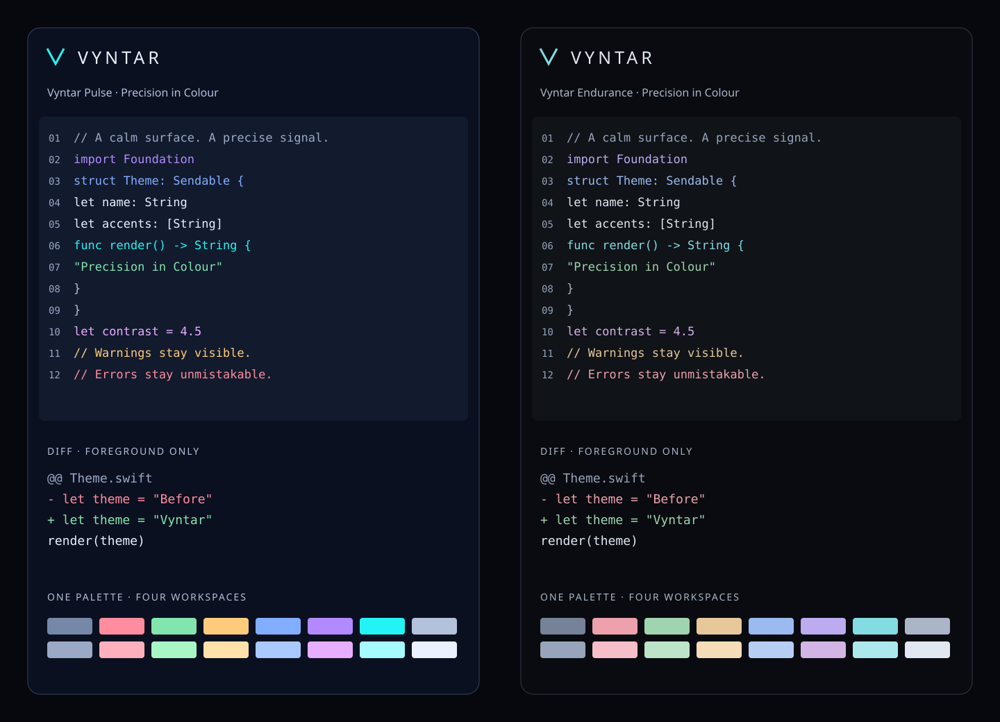

# Vyntar

**Precision in Colour.** Two dark themes, one semantic colour system, for Zed, Terminal.app, Xcode and Codex CLI.



**Pulse** pairs midnight blue surfaces with electric cyan, violet and laser blue. **Endurance** uses near-black surfaces and gentler accents. Both are opaque and static, with readable comments, neutral local variables and no font overrides. Endurance is a calmer appearance; no battery-life improvement is claimed.

Additions are mint, removals coral. `+` and `-` stay ordinary coloured text. Vyntar suppresses diff fills wherever the target exposes them. Selection and the current line retain their usual navigation cues.

This is **0.1.0 preview**. Generated files, contrast, native NSColor decoding and isolated lifecycle tests are verified. Interactive selection, native round trips and screenshots in all four applications still need human sign-off. See [compatibility](docs/COMPATIBILITY.md).

## Install

Download a versioned bundle or use this checkout. No network, Python, package manager or administrator access is required for installation. Run:

```sh
./install.sh --dry-run
./install.sh
```

To install a subset:

```sh
./install.sh --target zed,codex
```

The installer installs **both** variants, skips missing apps unless explicitly requested, stages Terminal imports and prints activation instructions. It does not change app preferences, shell startup files, fonts, running sessions or default Terminal profiles. An existing unmanaged file is a collision even if identical. Edited managed files are preserved and reported as conflicts.

| Target | Destination and activation |
| --- | --- |
| Zed | `~/.config/zed/themes/vyntar.json`. Open Theme Selector and choose **Vyntar Pulse** or **Vyntar Endurance**. |
| Terminal.app | `~/Library/Application Support/Vyntar/imports/`. In **Settings → Profiles**, use the action menu to **Import** the two `.terminal` files, then open a new window with the chosen profile. Set Default yourself if desired. |
| Xcode 27 | `~/Library/Developer/Xcode/UserData/FontAndColorThemes/`. **Settings → Appearance → Theme → Choose**. Reopen Xcode if the files do not appear. Fonts inherit from Xcode. |
| Codex CLI | `${CODEX_HOME:-$HOME/.codex}/themes/`. Run `/theme`; choose a Vyntar theme. The picker owns persistence. |

Terminal profiles set the ANSI palette, text, background, selection and a steady underline cursor. They omit commands, fonts, keyboard maps and startup behaviours. Existing tabs may retain their previous settings. Before replacing an imported profile, export any customisations in Terminal; then switch away, remove the old profile and re-import. Staging a file does **not** import it.

### Codex ANSI and diff text

Four Codex files are included:

- `vyntar-pulse-ansi` and `vyntar-endurance-ansi` use actual ANSI palette indices. Select the matching Vyntar host theme in Terminal.app or Zed for the intended colours. Their syntax rules are identical because the host supplies the difference.
- `vyntar-pulse` and `vyntar-endurance` specify RGB syntax colours for a consistent palette across capable hosts.

All four explicitly set diff-scope backgrounds to Codex's terminal-default marker `#00000001`. Omitting that field would let the current Codex renderer add its own red/green fills. This marker is renderer-specific, **not** a transparent RGB colour. Older Codex releases may ignore it. Use a current Codex build and verify a real file diff. Vyntar cannot alter hardcoded UI styling in another application or promise to suppress effects that its theme API does not expose. Code inside a syntax-aware diff can retain syntax colours while the signs identify additions and removals.

Other programs can emit their own backgrounds or RGB colours. A host ANSI profile does not override those. Do not force `TERM` or `COLORTERM` to misrepresent your terminal.

The custom-theme installation and `/theme` workflow follows [official OpenAI documentation](https://learn.chatgpt.com/docs/cli-customization). The default-marker implementation is documented in [Codex's renderer](https://github.com/openai/codex/blob/main/codex-rs/tui/src/render/highlight.rs) and [diff renderer](https://github.com/openai/codex/blob/main/codex-rs/tui/src/diff_render.rs).

## Manage and recover

The management command is installed at:

```sh
"$HOME/Library/Application Support/Vyntar/bin/vyntar" status
"$HOME/Library/Application Support/Vyntar/bin/vyntar" doctor
"$HOME/Library/Application Support/Vyntar/bin/vyntar" preview
```

You can also use `./bin/vyntar` from this checkout. `status` distinguishes installed files from staged profiles; it never guesses which theme an app has selected. `doctor` adds app availability. `preview` prints both palettes and foreground-only host ANSI samples. The [SVG comparison](assets/previews/vyntar.svg) shows both palettes independently of your host; it is a designed preview, not an application screenshot.

```sh
./update.sh --bundle /absolute/path/to/unpacked/vyntar-release --dry-run
./update.sh --bundle /absolute/path/to/unpacked/vyntar-release
./bin/vyntar restore TRANSACTION-ID --dry-run
./bin/vyntar restore TRANSACTION-ID
./uninstall.sh --dry-run
./uninstall.sh
```

A private state directory stores hashes, backups and transaction journals. Writes use a process lock, complete preflight and per-file atomic replacement. Failed or interrupted writes are reconciled against old/new hashes. Concurrent edits stop recovery and retain the backups. Every successful write prints its transaction ID. Restore reverses that transaction only while files still match its output. Restoring an install removes its new files; restoring an update reinstates its previous files. Backups and recovery records remain private until you remove them yourself.

Uninstall removes only unchanged tracked files. Edited files stay and produce exit 1. Switch to other themes before uninstalling. Remove imported Terminal profiles manually in Settings; keep any profile you customised. Empty application directories and recovery records are retained. For a subset, use `--target`; the manager remains installed.

A crash can leave a lock. Read `lock/owner.txt`, verify the recorded process is gone, then remove that owner file and empty lock directory. Rerun the original command to trigger pending-journal recovery. Do not discard the journal or backups while a conflict remains.

All commands accept `--plain`, `--non-interactive` and `--dry-run`. Dry runs perform no persistent writes, including locks. `NO_COLOR`, `TERM=dumb` and redirected output disable SGR. Exit codes: `0` success/no-op including expected manual steps, `1` runtime failure/conflict, `2` invalid arguments.

`CODEX_HOME` selects a custom Codex home. `VYNTAR_DATA_HOME` changes the private state root. `VYNTAR_APPLICATIONS` overrides `/Applications` for app discovery and isolated tests. Paths must be absolute and contain no tabs, newlines or dot segments. Symlink destinations/ancestors are refused; use their real physical paths.

### On-demand Adaptive

```sh
./bin/vyntar theme auto
./bin/vyntar theme pulse
./bin/vyntar theme endurance
```

This stores a preference and prints guidance. `auto` reads the current `pmset` power-source label; unknown readings recommend no change. Manual choices persist until `auto` is selected again. No helper is installed and no application selections are automated.

## Develop

From a source checkout, Python 3 is needed only for contributors. No third-party Python packages are required.

```sh
python3 generators/validate-palette.py
python3 generators/generate-themes.py
python3 generators/generate-themes.py --check
python3 -m unittest discover -s tests -v
python3 generators/package.py --archive
```

Edit swatches in `palette/palette.json`, role references in `palette/semantics.json`, and slots in `palette/ansi.json`. Both variants resolve the same contract. The generator validates all colours and contrast before replacing outputs. Run the package command after changing distributable files to refresh `MANIFEST.sha256`; archives and their SHA-256 files go in `dist/`. Manifest verification detects corrupt assets; authenticity depends on obtaining the bundle and digest through a trusted channel.

[Contrast results](docs/contrast.tsv) cover text, syntax, diagnostics, diff foregrounds, selections, UI surfaces, caret/focus and ANSI text. The minimum is 4.5:1 for text and 3:1 for essential indicators. This is a computed colour check, not a claim of whole-application WCAG conformance.

The [Zed schema](https://zed.dev/schema/themes/v0.2.0.json) is vendored for offline validation, with a source-derived overlay for current diff-hunk and word-diff controls. Older Zed builds may ignore those newer fields and retain native diff fills. Xcode uses a modern JSON workspace theme with explicit sRGB OKLCH colours and no font recipe. Legacy Xcode formats and unattended Adaptive are deferred.

MIT © Christopher Nicholson. See [LICENSE](LICENSE).
